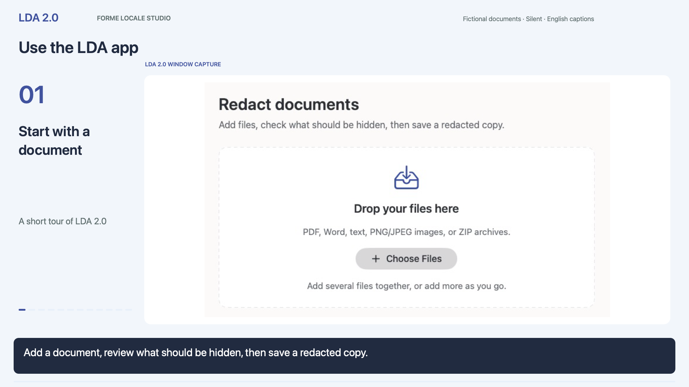
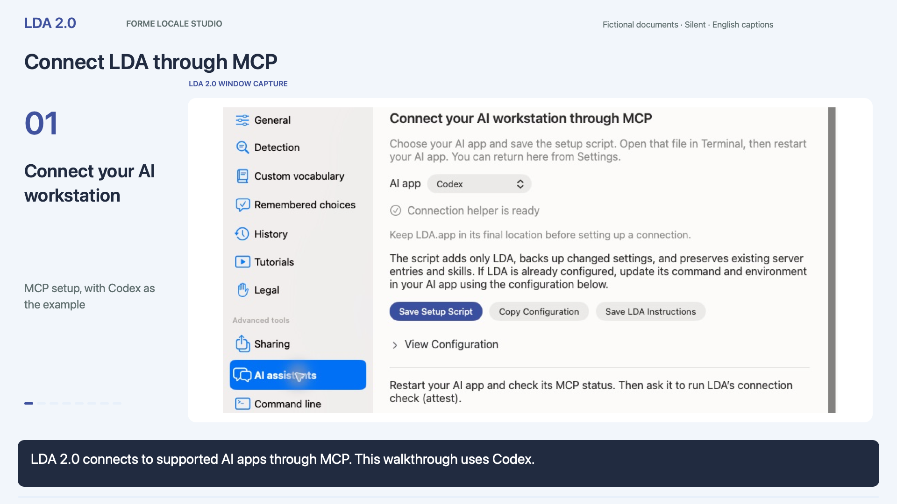

# LDA setup and video walkthroughs

Two refreshed walkthroughs using the released LDA 2.0 interface and fictional documents. Recorded app windows are combined with focused crops and clearly labeled explanatory cards. AI prompts and responses are illustrative. Both videos are silent, with English subtitles embedded in the picture. Recorded interactions are edited for pacing, not presented as performance benchmarks.

## Use the LDA app (1:19)

[](https://github.com/Reytian/LDA-App/releases/download/tutorials-20261103/lda-app-walkthrough.mp4)

[Watch or download the video](https://github.com/Reytian/LDA-App/releases/download/tutorials-20261103/lda-app-walkthrough.mp4) · [Read the transcript](tutorials/lda-app-walkthrough.md) · [Download captions](tutorials/lda-app-walkthrough.vtt)

1. Open LDA, review and accept the Terms of Service and Privacy Policy, then start with the included LDA V4 model. No model download is required.
2. In Redact, choose **Choose Files**, add a document, and choose **Scan Document**.
3. Review the findings and protect anything missed. Check **Safe Preview**.
4. Choose **Export for AI**. Send only the reviewed, redacted version to your AI app. Ask it to preserve placeholders exactly.
5. Save the edited result and open **Restore** in LDA. Use the matching local mapping, review the output, and save it.

## Connect LDA through MCP (1:27)

[](https://github.com/Reytian/LDA-App/releases/download/tutorials-20261103/lda-codex-walkthrough.mp4)

[Watch or download the video](https://github.com/Reytian/LDA-App/releases/download/tutorials-20261103/lda-codex-walkthrough.mp4) · [Read the transcript](tutorials/lda-codex-walkthrough.md) · [Download captions](tutorials/lda-codex-walkthrough.vtt)

LDA 2.0 includes the connection helper in **Settings > AI assistants**. The video uses Codex as the example. It records the LDA settings page and explains setup, prompting and the local document workflow with labeled cards. It does not show a live third-party AI conversation.

1. Put LDA.app in its final location. Open **Settings > AI assistants**, choose **Codex**, save its setup script, and open the script in Terminal.
2. Restart Codex and check the LDA MCP connection. Ask LDA to attest if you need to confirm it responds.
3. Type `/LDA`, select the LDA skill from the slash menu, and add your instruction. `$lda` is the alternate Codex skill reference.

   ```text
   /LDA Summarize the renewal terms.
   ```

4. Choose the document in LDA's local picker. Enable optional PII review to inspect or add protection. Confirm the Matter locally. Do not attach the original to the chat.
5. Review the redacted answer and any detection-coverage warnings.
6. For a result based on one document, ask: `Restore this summary locally and export it.` Review the saved result on your Mac. Keep separate document mappings separate.

The demonstrated integration is an LDA skill plus a local MCP connection. The verified entry points are `/LDA` and `$lda`; an `@LDA` plugin mention is not demonstrated or assumed to be available. A Matter name typed in chat is visible to the AI service. Omit it from the command and choose it locally when the label should stay private.

## Watch offline

LDA 2.0 includes both refreshed videos in the first-run workflow page, **Settings > Tutorials**, and **AI assistants**. Choose **Watch on GitHub** during setup to open the [video release](https://github.com/Reytian/LDA-App/releases/tag/tutorials-20261103) in your browser. The link opens only when selected and contains no document or Matter information. Open a bundled video and press Play; closing the player stops playback. A transcript is available below the player.

You can also download the [offline tutorial kit](https://github.com/Reytian/LDA-App/releases/download/tutorials-20261103/LDA-Tutorials.zip), extract it, and open `setup.html` in a browser. It has no external scripts, analytics, fonts or media requests.

Always review detection and the remaining context before sharing. Redaction does not guarantee that every identifying detail has been removed. Keep originals, mappings and passwords local.
